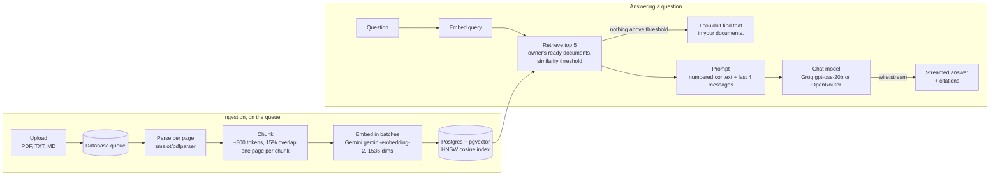
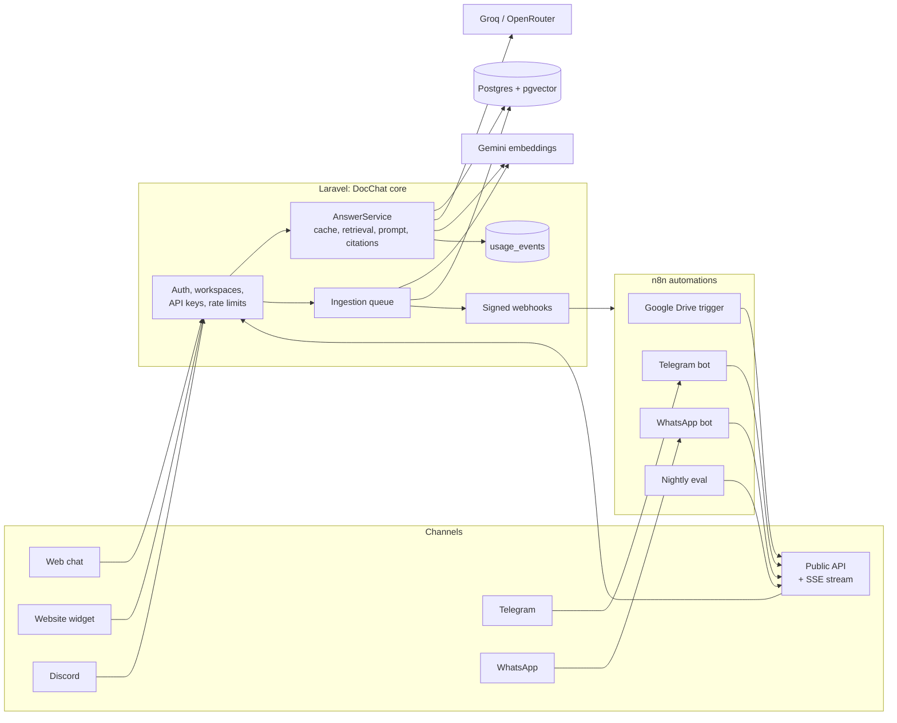
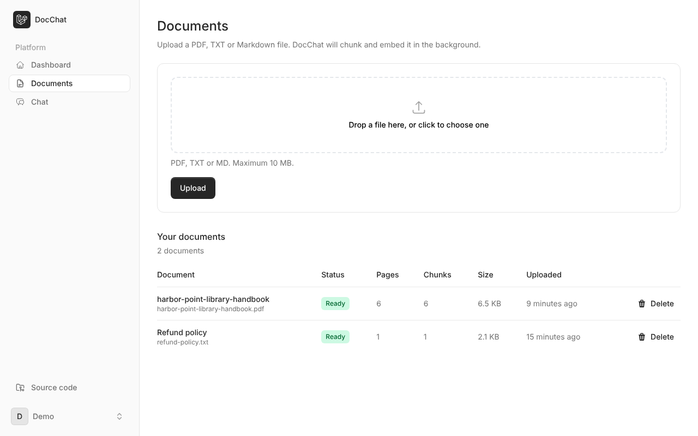
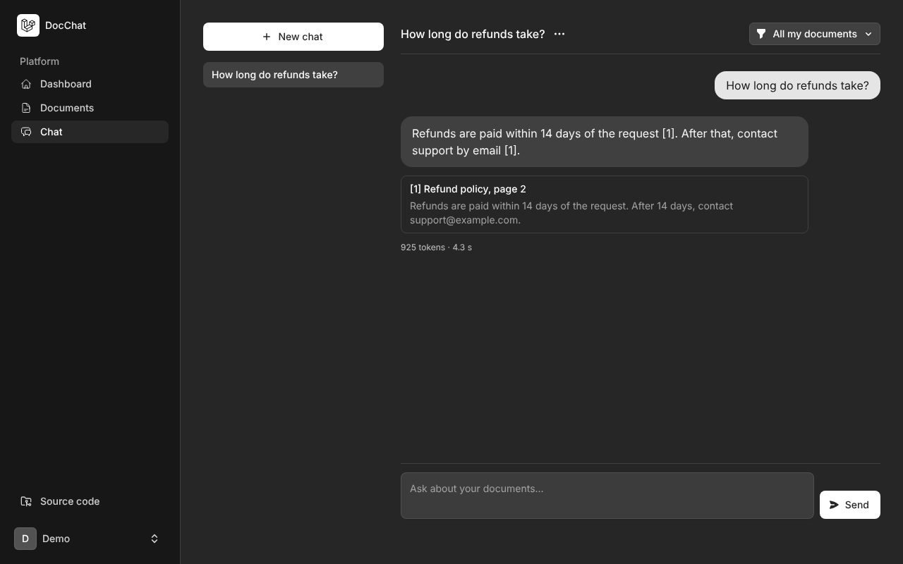

# DocChat

**Chat with your documents, and get answers you can check.**

DocChat is a Laravel app where you upload PDF, TXT or Markdown files and ask questions about them in a chat. Answers come only from your files, stream in word by word, and cite the exact document and page behind each fact, so you can click a source and read the passage yourself. When the answer isn't in your documents, DocChat says so instead of guessing. It's built like a small production product: workspaces for each client with members and invites, a versioned public API with keys, streaming and signed webhooks, an answer cache that saves tokens on repeated questions, usage tracking per channel, an evaluation command that measures retrieval quality, and 250+ tests that run without any API key.

> This is a portfolio project running on free tiers for testing. Upload test documents only: on the free Gemini tier, Google may use what you send to improve its products.


<!-- GIF placeholder: docs/demo.gif (upload a PDF, ask a question, expand a citation) -->

## Features

- **Upload** PDF, TXT and Markdown up to 10 MB, by picking a file or dragging it in. Files are stored privately and visible only to their owner.
- **Background ingestion** on a queue: text is extracted page by page, split into ~800-token chunks with 15% overlap that never cross a page, embedded in batches, and stored in Postgres with pgvector. Rate limits are retried with backoff; permanent errors (a scanned PDF, a bad key) fail fast with a clear message.
- **Live document list** with a status badge that updates while a file is processed, page and chunk counts, and delete (file, chunks and vectors).
- **Chat** over all your documents or a chosen few. The top 5 chunks by cosine similarity are retrieved, and anything under a configurable threshold is dropped. If nothing is left, the app answers "I couldn't find that in your documents." **without calling the model**.
- **Streaming answers** with inline citations like [1] and [2]. Under each answer: document title, page and snippet for every source, expandable to the full passage.
- **Follow-up questions** use the last 4 messages as context.
- **Usage line** under each answer (tokens and time), and a log line per answer for monitoring, without question or document text.
- **20 questions per minute per user** rate limit.
- **Evals:** `php artisan docchat:eval evals/sample.json` measures retrieval hit rate, keyword match, correct refusals and latency, and `--sweep` tunes the similarity threshold without spending chat calls.
- **Two chat providers** behind one interface: Groq (default) and OpenRouter, switched with one `.env` line.
- **Workspaces.** Each client gets a workspace with its own documents, chats, keys and usage. Owners add people who already have an account, or send an email invite link. A sidebar switcher moves between workspaces.
- **Public API** (`/api/v1`, docs at `/docs/api`): upload, list and delete documents, ask questions, or stream answers over Server-Sent Events. Optional `format` returns parts ready for Telegram, WhatsApp or Discord.
- **API keys** shown once, stored hashed, with abilities and their own rate limit (429 with `Retry-After`).
- **Signed webhooks** for `document.ready` and `document.failed`, retried with backoff.
- **Answer cache.** Repeated first questions are answered from the cache by exact or near-identical match (pgvector, 0.95 or more), and query embeddings are cached too. Everything is dropped when documents change. Hits and tokens saved show on the usage page.
- **Usage page** with monthly totals per channel: questions, tokens, cache hits and latency.
- **n8n automations** ([n8n/](n8n/README.md)): files dropped in a Google Drive folder are ingested automatically (Docs, Sheets and Slides as PDF), deleted Drive files are removed every night, and a nightly eval emails its scores. n8n runs in the same Docker stack with its own database.
- **Eval API:** `POST /api/v1/evals/run` runs an eval set in the background, one case per queued job, and posts signed results to a callback URL.

## How it works



The code follows the same split: `app/Services/Ingestion` (parsers, chunker), `app/Jobs/IngestDocumentJob`, `app/Services/Rag` (retriever, prompt builder, answer service, citation extractor), and drivers behind `app/Contracts/EmbeddingProvider` and `ChatProvider`. Livewire components stay thin and call the services.

## Architecture

Laravel owns the AI logic, data, auth, tenancy and usage tracking. n8n owns triggers and third-party integrations. Every channel goes through the same `AnswerService`, so retrieval, the prompt and citations behave the same everywhere.



## API quick start

Create a key in **Workspace settings → API keys**, then:

```bash
KEY=dc_live_...

# Upload (re-sending the same external_id replaces the document)
curl -H "Authorization: Bearer $KEY" -F file=@handbook.pdf -F external_id=handbook \
  https://your-domain/api/v1/documents

# Ask
curl -H "Authorization: Bearer $KEY" -H "Content-Type: application/json" \
  -d '{"question": "How long can I keep a DVD?", "format": "telegram_html"}' \
  https://your-domain/api/v1/ask

# Stream (Server-Sent Events: token ... then done)
curl -N -H "Authorization: Bearer $KEY" \
  "https://your-domain/api/v1/ask/stream?question=How%20long%20can%20I%20keep%20a%20DVD%3F"
```

Errors always look like `{"error": {"code": "...", "message": "...", "details": {...}}}`. The full reference, generated with Scramble, is at `/docs/api`.

## Security

- **Tenancy.** Every row belongs to a workspace. A global scope limits queries to the current workspace, and the retriever, jobs and API also filter by workspace explicitly, so nothing depends on the scope alone. Tests check each web page and API route across two workspaces.
- **API keys** are random 40-character secrets, stored only as SHA-256 hashes, with abilities and a per-key rate limit. Revoking one takes effect at once.
- **Invites** are single use, expire after 7 days, are stored hashed, and only work for the invited email.
- **Webhooks** carry `X-DocChat-Signature: sha256=<HMAC of the raw body>` and `X-DocChat-Timestamp`. Receivers should verify the HMAC and reject anything older than 5 minutes. Signing secrets are encrypted at rest.

## Design decisions and trade-offs

- **Chunk size and overlap.** About 800 tokens (estimated as 4 characters per token) with 15% overlap. That's big enough to keep a paragraph's context, and small enough that five chunks plus history stay near 5,000 input tokens, which fits Groq's free 8,000 tokens per minute. Chunks never cross a page, so every citation points to exactly one page.
- **Similarity threshold.** Cosine similarity below the threshold (default 0.5) is dropped before the model sees it, so weak matches can't turn into confident wrong answers and the "not found" path costs no model call. The right value depends on the embedding model, so it's tuned with `docchat:eval --sweep`, which trades retrieval hit rate against correct refusals.
- **pgvector instead of a hosted vector database.** Documents, chunks, vectors and ownership live in one Postgres database. Owner filtering is a normal SQL join, deletes cascade, backups are one `pg_dump`, and there's no second service to pay for or keep in sync. Laravel 13's native vector column, HNSW index and similarity queries mean no extra package. pgvector 0.8's iterative index scans keep filtered searches returning a full top 5.
- **Provider abstraction.** `EmbeddingProvider` and `ChatProvider` interfaces with drivers picked from config. Groq and OpenRouter share an OpenAI-compatible streaming base class. Every model name, dimension and URL lives in `config/docchat.php`, backed by `.env`.
- **Groq as the default chat provider.** Its free tier allows 1,000 requests a day, against OpenRouter's 50, which leaves room for eval runs. `openai/gpt-oss-20b` runs with low reasoning effort, and its reasoning text is never shown or stored.
- **`wire:stream` instead of a separate SSE endpoint.** The chat stays one Livewire component, so authentication, policies and the rate limiter work as everywhere else. Streamed text is HTML-escaped, because Livewire inserts it as HTML. The cost is one PHP-FPM worker held per open answer, which is fine at demo scale.
- **Gemini embeddings at 1536 dimensions.** pgvector's HNSW index supports up to 2,000 dimensions, so the model's 3072-dimension default wouldn't be indexable. `gemini-embedding-2` takes the task in the text (`task: search result | query: ...`), so the driver adds those prefixes. Each document records the embedding model it was indexed with.
- **Custom API keys instead of Sanctum.** The keys need a type (secret, public widget, service), abilities, allowed origins and a per-key limit, which is a small table and two middlewares. Sanctum would add a package without removing much of that work.
- **Answer cache only for first questions.** A follow-up depends on the chat before it, so caching it could return an answer to a different conversation. First questions, like widget FAQs, are where repeats happen. Each workspace has a `corpus_version` that goes up on every document change, so a cached answer can't outlive the documents it came from.
- **A fictional sample document.** The eval runs on a handbook for a made-up library (CC0). A model has already read the US Constitution, so it could answer from memory and hide retrieval mistakes; it can't know this handbook's fees and hours.

## Eval results

Run on `evals/sample.json` (10 cases: 8 answerable across 6 pages, 2 that should be refused) with `php artisan docchat:eval evals/sample.json`.

| Metric | Result |
|---|---|
| Retrieval hit rate (expected page in top 5) | _pending first real run_ |
| Keyword match rate | _pending first real run_ |
| Correct refusal rate | _pending first real run_ |
| Average latency | _pending first real run_ |

Each run also writes a JSON report with the full config to `storage/app/evals/`.

## Run it locally

You need Docker. Then:

```bash
git clone https://github.com/m0zee/docchat.git && cd docchat
cp .env.example .env                       # add GEMINI_API_KEY and GROQ_API_KEY
docker compose up -d --build
docker compose exec app sh -c "composer install && php artisan key:generate && php artisan migrate"
docker compose exec app php artisan db:seed --class=SampleDocumentSeeder
```

Open http://localhost:8000 and log in as `demo@docchat.test` / `password`. The sample handbook is indexed in the background; then ask something like "How long can I keep a DVD?". If ports 8000, 5173 or 5432 are taken (for example by Laragon), change `APP_PORT`, `VITE_PORT` or `DB_FORWARD_PORT` in `.env`.

### Tests

```bash
docker compose exec app composer ci:check   # Pint, PHPStan and the Pest suite
```

The tests need no API keys: every Gemini, Groq and OpenRouter call is faked, and stray HTTP requests fail the test. They do need the Postgres container, because retrieval is tested against real pgvector queries.

## Deploy

[`deploy.md`](deploy.md) walks through a free Oracle Cloud Always Free Arm VM with `docker-compose.prod.yml`: app, queue worker, scheduler, n8n, Postgres with pgvector, and Caddy with automatic HTTPS.

## Stack

Laravel 13, PHP 8.4, Livewire 4 with Flux, Tailwind 4, PostgreSQL 16 with pgvector 0.8, `smalot/pdfparser`, Pest 5, Docker (serversideup/php), Caddy. Embeddings: Google Gemini. Chat: Groq or OpenRouter.

## Roadmap

- Hybrid search: Postgres full-text plus vectors.
- Reranking the retrieved chunks before prompting.
- OCR for scanned PDFs, which currently fail with "No extractable text".

## Screenshots

| Documents | Chat (dark mode) |
|---|---|
|  |  |

## License

DocChat is released under the [MIT License](LICENSE). The sample handbook in `database/seeders/samples/` is CC0 (public domain).
