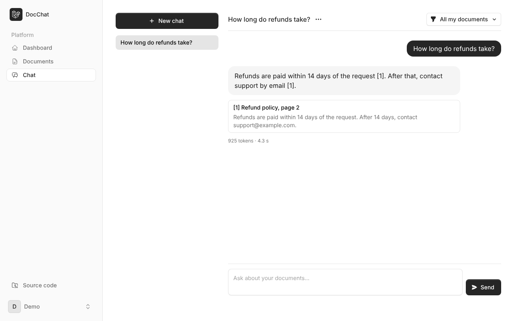
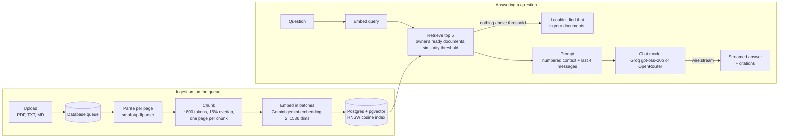
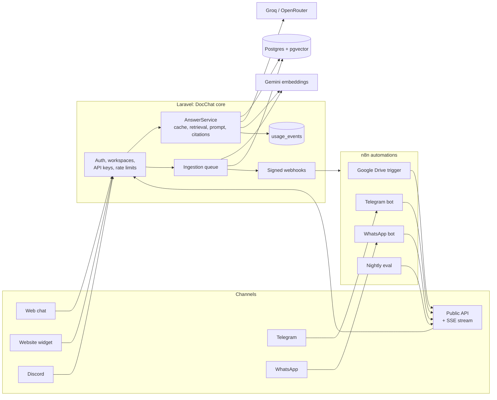
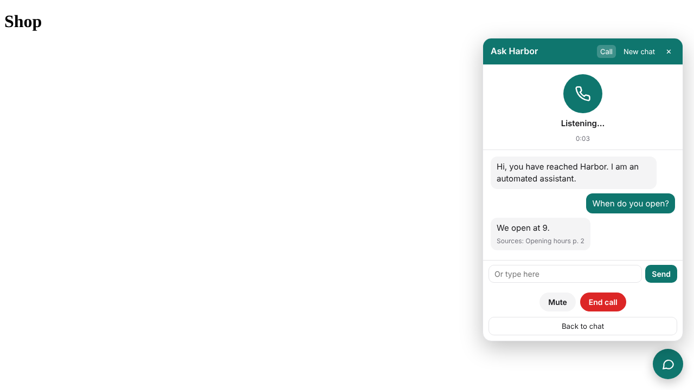
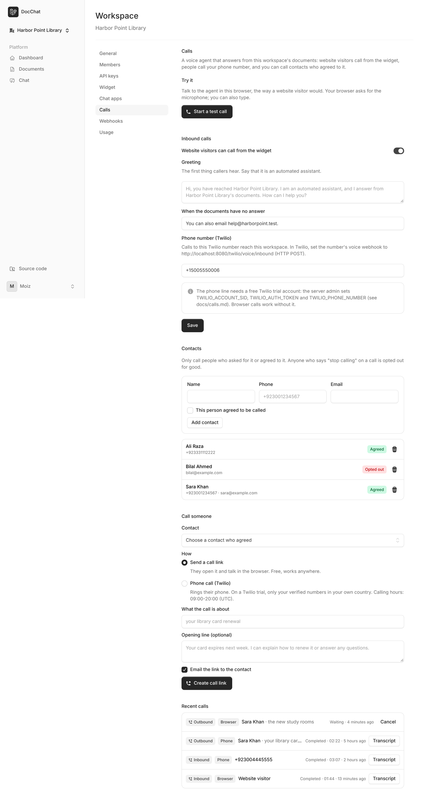
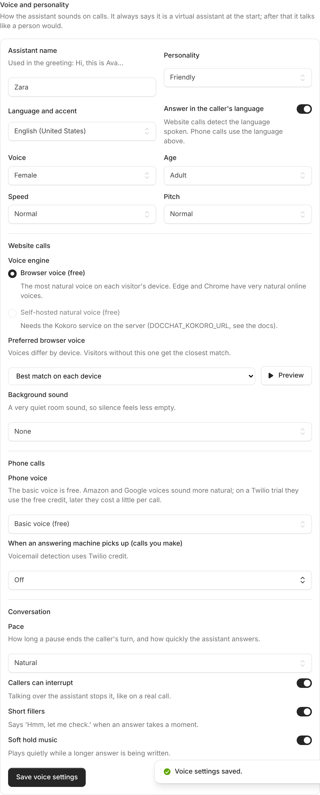
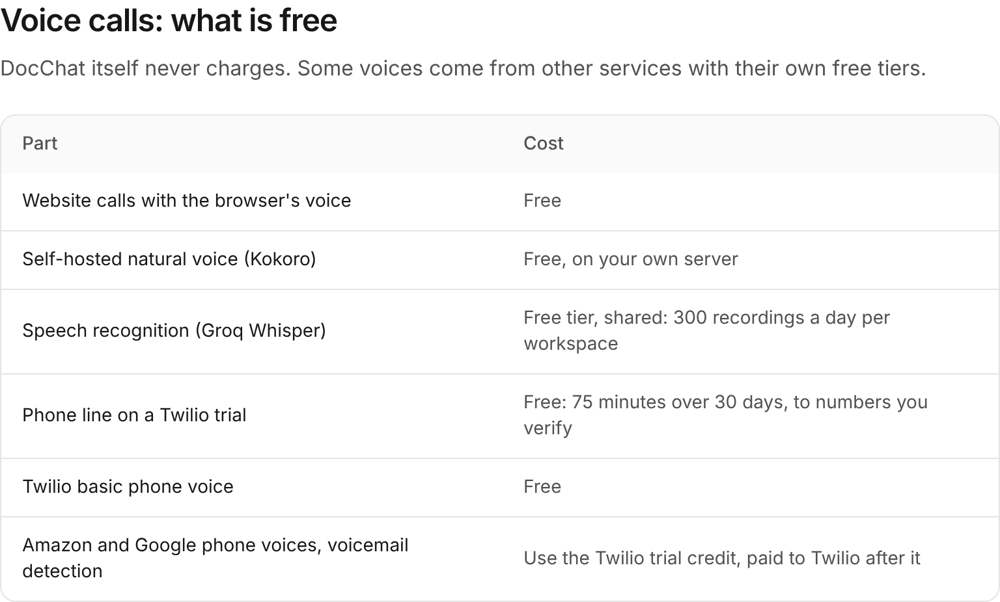

# DocChat

**Chat with your documents, and get answers you can check.**

DocChat is a Laravel app where you upload PDF, TXT or Markdown files and ask questions about them in a chat. Answers come only from your files, stream in word by word, and cite the exact document and page behind each fact, so you can click a source and read the passage yourself. When the answer isn't in your documents, DocChat says so instead of guessing. It's built like a small production product: workspaces for each client with members and invites, a website widget for guests, Telegram, WhatsApp and Discord bots that share one answer engine, a calling agent for website and phone calls with natural voices in seven languages, a versioned public API with keys, streaming and signed webhooks, n8n automations for Google Drive and nightly evals, an answer cache that saves tokens on repeated questions, usage tracking per channel, and 440+ tests that run without any API key.

> This is a portfolio project running on free tiers for testing. Upload test documents only: on the free Gemini tier, Google may use what you send to improve its products.



<!-- GIF placeholder: docs/demo.gif (upload a PDF, ask a question, expand a citation) -->

## Features

- **Upload** PDF, TXT and Markdown up to 10 MB, by picking a file or dragging it in. Files are stored privately and visible only inside their workspace.
- **Background ingestion** on a queue: text is extracted page by page, split into ~800-token chunks with 15% overlap that never cross a page, embedded in batches, and stored in Postgres with pgvector. Rate limits are retried with backoff; permanent errors (a scanned PDF, a bad key) fail fast with a clear message.
- **Live document list** with a status badge that updates while a file is processed, page and chunk counts, and delete (file, chunks and vectors).
- **Chat** over all your documents or a chosen few. The top 5 chunks by cosine similarity are retrieved, and anything under a configurable threshold is dropped. If nothing is left, the app answers "I couldn't find that in your documents." **without calling the model**.
- **Streaming answers** with inline citations like [1] and [2]. Under each answer: document title, page and snippet for every source, expandable to the full passage.
- **Follow-up questions** use the last 4 messages as context.
- **Usage line** under each answer (tokens and time), and a log line per answer for monitoring, without question or document text.
- **20 questions per minute per user** rate limit.
- **Evals:** `php artisan docchat:eval evals/sample.json` measures retrieval hit rate, keyword match, correct refusals and latency, and `--sweep` tunes the similarity threshold without spending chat calls.
- **Two chat providers** behind one interface: Groq (default) and OpenRouter, switched with one `.env` line.
- **Workspaces.** Each client gets a workspace with its own documents, chats, keys and usage. Owners add people who already have an account, or send an email invite link. A sidebar switcher moves between workspaces.
- **Public API** (`/api/v1`, docs at `/docs/api`): upload, list and delete documents, ask questions, or stream answers over Server-Sent Events. Optional `format` returns parts ready for Telegram, WhatsApp or Discord.
- **API keys** shown once, stored hashed, with abilities and their own rate limit (429 with `Retry-After`).
- **Signed webhooks** for `document.ready` and `document.failed`, retried with backoff.
- **Answer cache.** Repeated first questions are answered from the cache by exact or near-identical match (pgvector, 0.95 or more), and query embeddings are cached too. Everything is dropped when documents change. Hits and tokens saved show on the usage page.
- **Usage page** with monthly totals per channel: questions, tokens, cache hits and latency.
- **n8n automations** ([n8n/](n8n/README.md)): files dropped in a Google Drive folder are ingested automatically (Docs, Sheets and Slides as PDF), deleted Drive files are removed every night, and a nightly eval emails its scores. n8n runs in the same Docker stack with its own database.
- **Website widget** for guests, the main way visitors ask: one `<script>` tag from **Workspace > Widget** adds a chat bubble (vanilla JS in a Shadow DOM, about 14 KB, streaming, sources, saved history, mobile and dark mode). Its public `dc_pub_` key only asks, only from the websites the owner lists, with a per-visitor rate limit. When the documents have no answer, it shows the owner's handoff email.
- **Telegram bot** ([setup](n8n/README.md#telegram-bot)): one bot for every workspace. An owner links a chat with a one-time code from **Workspace > Chat apps**; the chat then gets answers with sources from that workspace, keeps its own conversation (`/new` starts over), and can add documents by sending a file. In groups it answers only when mentioned.
- **Discord** ([setup](docs/discord.md)): `/ask`, `/link`, `/new` and `/unlink` slash commands answered by DocChat itself, with Ed25519-verified requests, deferred answers from the queue, and mentions disabled.
- **WhatsApp bot** ([setup](n8n/README.md#whatsapp-bot)) on Meta's Cloud API through n8n, linked the same way, replying only inside WhatsApp's 24-hour window.
- **Calling agent** ([setup](docs/calls.md)): a voice agent that answers from the workspace's documents. Website visitors press **Call** in the widget and talk in the browser (Groq Whisper hears them, a natural voice reads the answer). Owners call contacts who agreed to it, with a call link or a real phone call through a free Twilio trial, and people can ring the workspace's Twilio number. Every call says it is a virtual assistant, keeps a transcript and a log under **Workspace > Calls**, and "stop calling" opts the person out for good.
- **Natural-sounding voice** (**Workspace > Calls > Voice and personality**): the assistant's name and personality, language and accent (English in four accents, Spanish, French, German, Hindi, Urdu, Arabic), answering in the caller's language (Whisper detects it), female or male voice, age, speed and pitch, with previews. Callers can interrupt; the agent waits a natural moment, says a short filler and plays soft hold music while a longer answer is written, and can add a quiet background sound. Voices: the best one in the visitor's browser, the self-hosted open Kokoro voice (free, also on the phone line), or Twilio's free basic voice and paid Amazon and Google voices, labeled as such. Outbound phone calls can detect voicemail and hang up or leave a short message.
- **Voice notes** in Telegram and WhatsApp are transcribed and answered, and can be answered with audio too.
- **Bring your own key** (**Workspace > AI keys**): an owner pastes their own free Groq or Gemini key, and the workspace's answers use it instead of the app's keys. A Gemini key also embeds the workspace's documents and questions (same model, so vectors stay compatible either way). Keys are checked with a free "list models" call before saving, encrypted with `APP_KEY`, never shown again, and flagged on the page when the provider rejects them.
- **AI in the browser** (optional): the server still searches the documents, but the answer is written on the asker's device, so it costs no model tokens. The chat page offers Chrome's built-in AI (Prompt API with Gemini Nano, Chrome 148+ on desktop) and WebLLM (a small open model on WebGPU, loaded from a CDN only when picked) and hides the choice when the browser supports neither. The widget can use Chrome's built-in AI for visitors who already have the model, when the owner turns it on, and falls back to the server otherwise.
- **Public site:** a landing page, a pricing page (every plan is free: hosted, bring your own key, or self-host) and a user guide at `/docs` written in Markdown (`resources/docs/`), next to the generated API reference at `/docs/api`.
- **Eval API:** `POST /api/v1/evals/run` runs an eval set in the background, one case per queued job, and posts signed results to a callback URL.

## Channels

Every channel uses the same `AnswerService`, so retrieval, the refusal rule, citations, the answer cache and usage tracking behave the same everywhere. Answers are formatted per channel (`plain`, `markdown`, `telegram_html`, `whatsapp`, `discord`) and split under each app's message limit.

| Channel | Who asks | How it connects | Setup |
|---|---|---|---|
| Web chat | workspace members | Livewire, `wire:stream` | built in |
| Website widget | guests on the client's site | `<script>` tag, public key locked to listed sites | Workspace > Widget |
| Public API | the client's own systems | `dc_live_` key, JSON or Server-Sent Events | Workspace > API keys, `/docs/api` |
| Telegram | anyone in a linked chat | n8n workflow, platform service key | [n8n/README.md](n8n/README.md#telegram-bot) |
| WhatsApp | anyone who messages the number | n8n workflow, platform service key | [n8n/README.md](n8n/README.md#whatsapp-bot) |
| Discord | members of a linked server | slash commands to `/discord/interactions` | [docs/discord.md](docs/discord.md) |
| Voice calls in the browser | guests on the client's site, or contacts with a call link | widget **Call** button or `/call/<token>`, one-call `dc_call_` token | Workspace > Calls |
| Phone calls | anyone who rings the Twilio number, or contacts who agreed | Twilio webhooks with `<Gather>` speech, `<Say>` or `<Play>` (Kokoro) | [docs/calls.md](docs/calls.md) |

One bot per chat app serves every workspace. An owner creates a one-time code under **Workspace > Chat apps**, and the code links that chat or server to the workspace.

## How it works



The code follows the same split: `app/Services/Ingestion` (parsers, chunker), `app/Jobs/IngestDocumentJob`, `app/Services/Rag` (retriever, prompt builder, answer service, citation extractor), and drivers behind `app/Contracts/EmbeddingProvider` and `ChatProvider`. Livewire components stay thin and call the services.

## Architecture

Laravel owns the AI logic, data, auth, tenancy and usage tracking. n8n owns triggers and third-party integrations. Every channel goes through the same `AnswerService`, so retrieval, the prompt and citations behave the same everywhere.



## API quick start

Create a key in **Workspace settings → API keys**, then:

```bash
KEY=dc_live_...

# Upload (re-sending the same external_id replaces the document)
curl -H "Authorization: Bearer $KEY" -F file=@handbook.pdf -F external_id=handbook \
  https://your-domain/api/v1/documents

# Ask
curl -H "Authorization: Bearer $KEY" -H "Content-Type: application/json" \
  -d '{"question": "How long can I keep a DVD?", "format": "telegram_html"}' \
  https://your-domain/api/v1/ask

# Stream (Server-Sent Events: token ... then done)
curl -N -H "Authorization: Bearer $KEY" \
  "https://your-domain/api/v1/ask/stream?question=How%20long%20can%20I%20keep%20a%20DVD%3F"
```

For the website, save **Workspace > Widget** once and paste the snippet it shows:

```html
<script src="https://your-domain/widget.js" data-key="dc_pub_..." async></script>
```

Run the eval set and get the results posted back, signed:

```bash
curl -H "Authorization: Bearer $KEY" -H "Content-Type: application/json" \
  -d '{"eval_set": "sample", "callback_url": "https://example.com/hooks/eval"}' \
  https://your-domain/api/v1/evals/run
```

Errors always look like `{"error": {"code": "...", "message": "...", "details": {...}}}`. The full reference, generated with Scramble, is at `/docs/api`.

## Automations (n8n)

n8n runs next to DocChat in the same Docker stack, with its own database, and talks to it only through the public API and signed webhooks. The workflows in [`n8n/`](n8n/README.md) hold no credentials, and a test fails if an export ever does.

| Workflow | What it does |
|---|---|
| Google Drive ingest | New or changed files in a Drive folder are uploaded (Google Docs, Sheets and Slides as PDF). When DocChat finishes, a signed webhook triggers an email. |
| Remove deleted Drive files | Every night, deletes documents whose Drive file is gone, with guards against deleting everything. |
| Nightly eval | Runs the eval set through `POST /api/v1/evals/run`, waits for the signed callback, and emails the scores. |
| Telegram bot / WhatsApp bot | One bot for every workspace, linked per chat with a code. |

<!-- Screenshot placeholders: docs/screenshots/n8n-drive-ingest.png, docs/screenshots/n8n-telegram-bot.png -->

## Security

- **Tenancy.** Every row belongs to a workspace. A global scope limits queries to the current workspace, and the retriever, jobs and API also filter by workspace explicitly, so nothing depends on the scope alone. Tests check each web page and API route across two workspaces.
- **API keys** are random 40-character secrets, stored only as SHA-256 hashes, with abilities and a per-key rate limit. Revoking one takes effect at once.
- **Invites** are single use, expire after 7 days, are stored hashed, and only work for the invited email.
- **Widget keys** (`dc_pub_`) are public by design. They can only ask, only from the websites the owner lists (checked on the server against `Origin`), only in guest conversations named by a random visitor id, and with a rate limit per visitor.
- **Service keys** (`dc_svc_`) for the shared bots belong to no workspace. They act only in the workspace of a chat that an owner linked with a one-time code (hashed, 15 minutes, single use), named in the `X-DocChat-Link` header.
- **Discord** requests are verified with Ed25519 over the timestamp and raw body, and anything older than 5 minutes is refused.
- **Calls.** A browser call's `dc_call_` token works for one call only, stored hashed, until it ends or expires. Twilio webhooks are checked with Twilio's `X-Twilio-Signature` and the call's own `CallSid`; Kokoro clips Twilio plays are behind DocChat's own HMAC. The voice endpoint only speaks the call's own lines, so a call token can't be used as free text to speech. Outbound calls only go to contacts with recorded consent, never after an opt-out, and phone calls only inside the calling hours. Every greeting, outbound opening and voicemail says it is a virtual assistant; a custom greeting that doesn't gets it added.
- **Own AI keys** are encrypted at rest with `APP_KEY` (rotate it with `APP_PREVIOUS_KEYS`, or the keys can't be read), hidden from serialization, and only owners can see or change them. Only the last four characters are shown.
- **On-device answers** are text from the browser, so they are treated as untrusted: they need a single-use, 10-minute token tied to the conversation, are shown only in that conversation, and never enter the shared answer cache. Citations are still mapped on the server from the chunks it retrieved.
- **Webhooks** carry `X-DocChat-Signature: sha256=<HMAC of the raw body>` and `X-DocChat-Timestamp`. Receivers should verify the HMAC and reject anything older than 5 minutes. Signing secrets are encrypted at rest.

## What it costs

DocChat has no paid plan (see `/pricing`). Everything runs on free tiers; the only things that can cost money are optional choices from Twilio, and the app labels them.

| Part | Free tier used | Limits | Costs money when |
|---|---|---|---|
| Answers | Groq (default), or Gemini / OpenRouter | Groq: 1,000 requests a day; shared unless a workspace adds its own free key | Never on free keys |
| Search (embeddings) | Google Gemini | Free tier rate limits | Never on free keys |
| Speech to text | Groq Whisper | 20 a minute, 2,000 a day; 300 a day per workspace | Never |
| Website call voice | The browser's own voices, or self-hosted Kokoro | Kokoro needs about 2 GB of RAM | Never |
| Voice replies in bots | Kokoro, or Groq Orpheus | Orpheus: 100 a day, needs ffmpeg | Never |
| Phone line | Twilio trial, no card | 75 minutes over 30 days, verified numbers only, 10 minutes a call | After the trial, Twilio bills minutes and the number |
| Phone voices | Twilio basic voice | | Amazon Polly and Google voices use trial credit, then a per-100-characters charge |
| Voicemail detection | Twilio | Off by default | Uses trial credit, then a per-call charge |
| WhatsApp | Meta's test number | 24-hour window | See [n8n/README.md](n8n/README.md#whatsapp-bot) |
| Hosting | Oracle Cloud Always Free VM | | Never on Always Free |

## Design decisions and trade-offs

- **Chunk size and overlap.** About 800 tokens (estimated as 4 characters per token) with 15% overlap. That's big enough to keep a paragraph's context, and small enough that five chunks plus history stay near 5,000 input tokens, which fits Groq's free 8,000 tokens per minute. Chunks never cross a page, so every citation points to exactly one page.
- **Similarity threshold.** Cosine similarity below the threshold (default 0.5) is dropped before the model sees it, so weak matches can't turn into confident wrong answers and the "not found" path costs no model call. The right value depends on the embedding model, so it's tuned with `docchat:eval --sweep`, which trades retrieval hit rate against correct refusals.
- **pgvector instead of a hosted vector database.** Documents, chunks, vectors and ownership live in one Postgres database. Owner filtering is a normal SQL join, deletes cascade, backups are one `pg_dump`, and there's no second service to pay for or keep in sync. Laravel 13's native vector column, HNSW index and similarity queries mean no extra package. pgvector 0.8's iterative index scans keep filtered searches returning a full top 5.
- **Provider abstraction.** `EmbeddingProvider` and `ChatProvider` interfaces with drivers picked from config. Groq and OpenRouter share an OpenAI-compatible streaming base class. Every model name, dimension and URL lives in `config/docchat.php`, backed by `.env`.
- **Groq as the default chat provider.** Its free tier allows 1,000 requests a day, against OpenRouter's 50, which leaves room for eval runs. `openai/gpt-oss-20b` runs with low reasoning effort, and its reasoning text is never shown or stored.
- **`wire:stream` instead of a separate SSE endpoint.** The chat stays one Livewire component, so authentication, policies and the rate limiter work as everywhere else. Streamed text is HTML-escaped, because Livewire inserts it as HTML. The cost is one PHP-FPM worker held per open answer, which is fine at demo scale.
- **Gemini embeddings at 1536 dimensions.** pgvector's HNSW index supports up to 2,000 dimensions, so the model's 3072-dimension default wouldn't be indexable. `gemini-embedding-2` takes the task in the text (`task: search result | query: ...`), so the driver adds those prefixes. Each document records the embedding model it was indexed with.
- **Custom API keys instead of Sanctum.** The keys need a type (secret, public widget, service), abilities, allowed origins and a per-key limit, which is a small table and two middlewares. Sanctum would add a package without removing much of that work.
- **Answer cache only for first questions.** A follow-up depends on the chat before it, so caching it could return an answer to a different conversation. First questions, like widget FAQs, are where repeats happen. Each workspace has a `corpus_version` that goes up on every document change, so a cached answer can't outlive the documents it came from.
- **Who pays for the model.** Answers run on the app's free keys by default. Bringing your own key moves a workspace onto its own free quota, and on-device answers move it onto the asker's hardware. All three stay free; borrowing people's ChatGPT, Gemini or Claude subscriptions would break those services' terms, so it isn't offered. On-device mode retrieves 3 chunks instead of 5 because small local models have small context windows, and it is opt-in because local models are slower and less accurate.
- **Voices that sound human, without paying for them.** The browser's own `speechSynthesis` has very natural voices on Edge and Chrome, so it is the default; the agent scores the device's voices by language, "Natural"/"Neural"/"Online" names and gender. For one consistent voice, Kokoro (82M parameters, Apache-2.0) runs on CPU next to the app, and its clips are cached. Streaming audio to the phone (Twilio `<Stream>`) would allow lower latency, but trials block it, so the phone line keeps `<Gather>` and covers the wait with a filler and a hold sound while a job writes the answer. The agent never pretends to be human: being natural is about pace, interruptions and wording, not hiding that it is an AI.
- **A fictional sample document.** The eval runs on a handbook for a made-up library (CC0). A model has already read the US Constitution, so it could answer from memory and hide retrieval mistakes; it can't know this handbook's fees and hours.

## Eval results

Run on `evals/sample.json` (10 cases: 8 answerable across 6 pages, 2 that should be refused) with `php artisan docchat:eval evals/sample.json`.

| Metric | Result |
|---|---|
| Retrieval hit rate (expected page in top 5) | _pending first real run_ |
| Keyword match rate | _pending first real run_ |
| Correct refusal rate | _pending first real run_ |
| Average latency | _pending first real run_ |

Each run also writes a JSON report with the full config to `storage/app/evals/`.

## Run it locally

You need Docker. Then:

```bash
git clone https://github.com/m0zee/docchat.git && cd docchat
cp .env.example .env                       # add GEMINI_API_KEY and GROQ_API_KEY
docker compose up -d --build
docker compose exec app sh -c "composer install && php artisan key:generate && php artisan migrate"
docker compose exec app php artisan db:seed --class=SampleDocumentSeeder
```

Open http://localhost:8000 and log in as `demo@docchat.test` / `password`. The sample handbook is indexed in the background; then ask something like "How long can I keep a DVD?". If ports 8000, 5173 or 5432 are taken (for example by Laragon), change `APP_PORT`, `VITE_PORT` or `DB_FORWARD_PORT` in `.env`.

### Tests

```bash
docker compose exec app composer ci:check   # Pint, PHPStan and the Pest suite
```

CI also imports every n8n workflow into the pinned n8n image, builds the production image, and checks the widget and voice calls in Chromium with a fake microphone (`tests/browser/widget.cjs`, `tests/browser/voice-call.cjs`).

The tests need no API keys: every Gemini, Groq, OpenRouter and Twilio call is faked, and stray HTTP requests fail the test. They do need the Postgres container, because retrieval is tested against real pgvector queries.

## Deploy

[`deploy.md`](deploy.md) walks through a free Oracle Cloud Always Free Arm VM with `docker-compose.prod.yml`: app, queue worker, scheduler, n8n, Postgres with pgvector, and Caddy with automatic HTTPS. The same HTTPS address serves `/widget.js` and Discord's `/discord/interactions`, and n8n gets its own subdomain.

A short demo script for screen recordings is in [`docs/demo-script.md`](docs/demo-script.md), and [`public/demo-site.html`](public/demo-site.html) is a sample client page that embeds the widget.

## Stack

Laravel 13, PHP 8.4, Livewire 4 with Flux, Tailwind 4, PostgreSQL 16 with pgvector 0.8, `smalot/pdfparser`, Pest 5, Docker (serversideup/php), Caddy. Embeddings: Google Gemini. Chat: Groq or OpenRouter. Voice: Groq Whisper, browser `speechSynthesis`, Kokoro-FastAPI (optional), Twilio.

## Roadmap

- Hybrid search: Postgres full-text plus vectors.
- Reranking the retrieved chunks before prompting.
- Billing with Stripe on top of `usage_events`, which already records tokens, cache savings and channel per question.
- OCR for scanned PDFs, which currently fail with "No extractable text".

## Screenshots

| Documents | Chat (dark mode) |
|---|---|
|  |  |

| Calling from the widget | Workspace > Calls |
|---|---|
|  |  |

| Voice and personality | Pricing |
|---|---|
|  |  |

## License

DocChat is released under the [MIT License](LICENSE). The sample handbook in `database/seeders/samples/` is CC0 (public domain).
